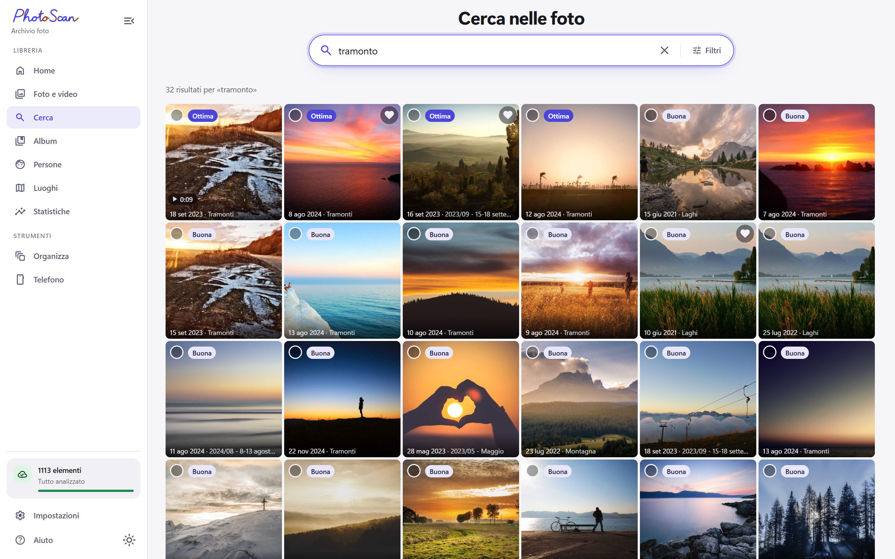
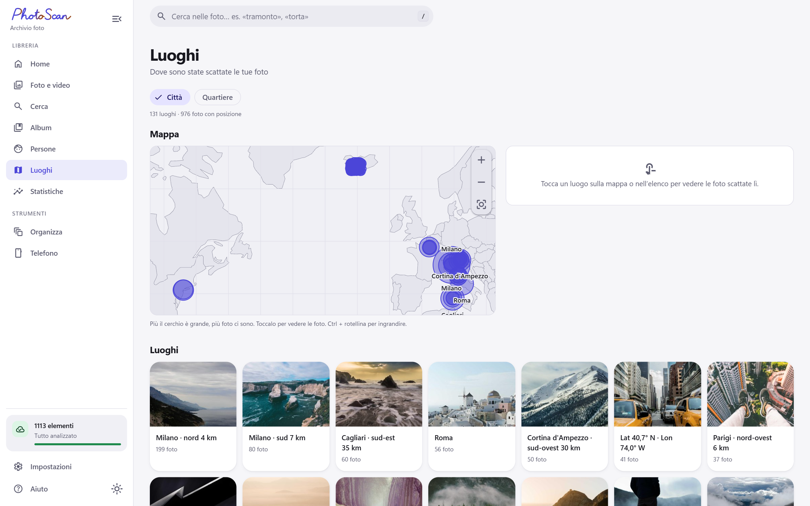
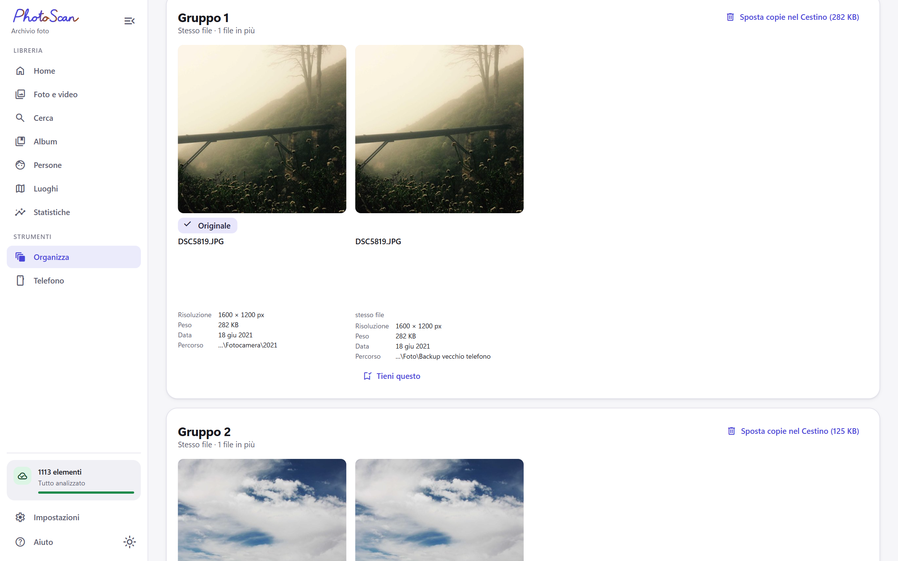

# PhotoScan

PhotoScan mette in ordine il tuo archivio di foto e video, tutto sul tuo computer:

- riconosce cosa c'è nelle foto e ti permette di cercarle a parole ("tramonto", "torta");
- trova duplicati e foto simili, e ti propone una struttura di cartelle per anno, mese ed evento;
- importa foto e video da un telefono Android o da un iPhone collegato via USB.

Nessuna foto viene inviata online.

**Regola fondamentale: PhotoScan non cancella mai nulla.** Le foto originali restano in sola lettura.

| Home | Ricerca | Luoghi |
| --- | --- | --- |
|  |  |  |
| **Galleria** | **Duplicati** | **Tema scuro** |
|  |  |  |

## Installazione (Windows)

1. Scarica **PhotoScan-Setup.exe** dall'[ultima Release](https://github.com/RedErik21/PhotoScan/releases/latest).
2. Aprilo e segui la procedura guidata: il programma controlla il PC e propone la configurazione migliore.
3. Al termine trovi l'icona **PhotoScan** sul Desktop.

Il modello di riconoscimento si scarica una sola volta, al primo avvio.

## Primo avvio

PhotoScan ti chiede due cartelle:

- **la cartella delle foto**: viene solo letta;
- **la cartella di destinazione**: dove verrà creato l'archivio ordinato.

Poi avvia l'analisi. Puoi interromperla in qualsiasi momento: alla riapertura riprende dai file non ancora elaborati.
Le impostazioni si cambiano in qualsiasi momento nella sezione **Impostazioni**.

## Sicurezza

- Le foto originali vengono solo lette.
- Prima di creare le cartelle vedi l'anteprima: nulla cambia sul disco finché non confermi.
- I duplicati esatti finiscono in `_Duplicati/`, le foto simili in `_Duplicati/Simili/`. Nulla viene eliminato:
  controlla la cartella **Simili** prima di confermare, perché foto molto scure possono sembrare uguali.
- Ogni operazione lascia un registro nella cartella di destinazione.

## Aggiornamenti

PhotoScan controlla le nuove versioni all'avvio. Il controllo si può disattivare in **Impostazioni > Aggiornamenti**.

- Non viene inviata nessuna foto né alcun dato dell'archivio.
- L'aggiornamento si installa alla riapertura, con copia di riserva automatica.
- Foto, catalogo e impostazioni non vengono toccati.

## Problemi comuni

- **Il primo avvio è lento:** è normale, può richiedere fino a due minuti.
- **Un file non viene analizzato:** l'analisi prosegue e l'errore è elencato nella sezione **Indicizzazione**. Puoi riprovarlo dall'app.
- **Ho chiuso la finestra durante l'analisi:** l'analisi si ferma in sicurezza e riprende alla prossima apertura.
- **Il programma non si apre:** il file `fotoscan_ui.log` nella cartella di PhotoScan contiene il motivo.

## Per sviluppatori

Installazione dal codice, comandi da terminale, struttura del progetto, test e procedura di release sono in
[docs/SVILUPPO.md](docs/SVILUPPO.md).

## Licenza

Distribuito con licenza MIT: vedi [`LICENSE`](LICENSE). Le librerie in `frontend/vendor/` e i modelli
scaricati da Hugging Face hanno le proprie licenze.
