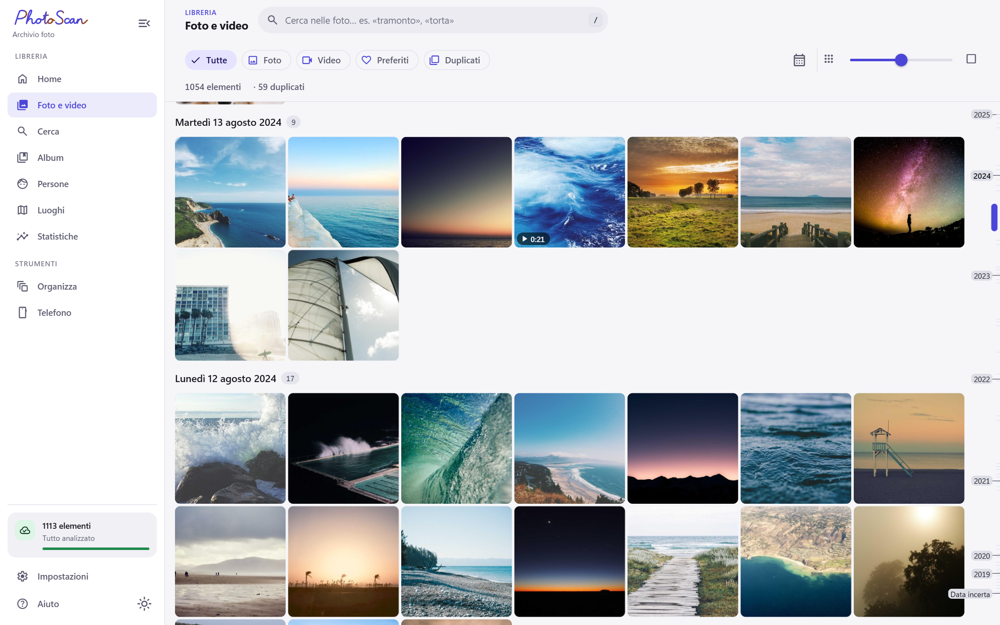
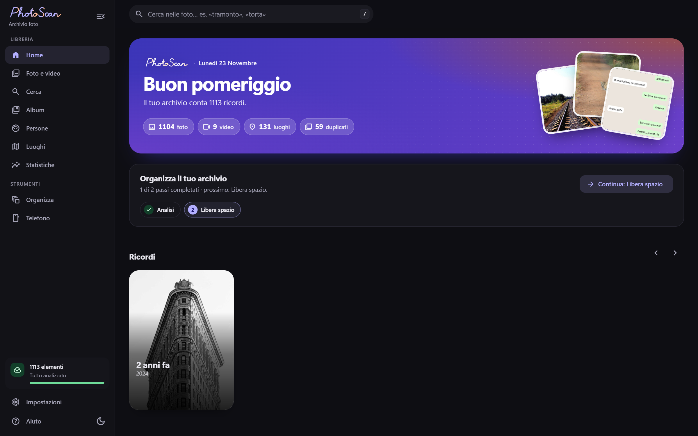

# PhotoScan

PhotoScan è un'applicazione locale (nessun servizio online: solo il controllo degli aggiornamenti, disattivabile) che indicizza un archivio di foto e video
(pensato per circa 200 GB, ~14.000 file), riconosce il contenuto delle immagini con un modello di
intelligenza artificiale (SigLIP2, eseguito sul proprio PC) e propone un'organizzazione in cartelle
per anno, mese ed evento. Permette di sfogliare, cercare a parole ("tramonto", "torta"), gestire
duplicati, album e preferiti, e infine di creare la nuova struttura di cartelle.
Può anche importare foto e video da un telefono Android o da un iPhone collegato via USB: il telefono viene solo letto e nulla viene cancellato. Con l'iPhone si importa solo la cartella DCIM (foto e video della fotocamera).

**Regola fondamentale: PhotoScan non cancella mai nulla.** La cartella delle foto originali è
sempre in sola lettura.

| Home | Ricerca | Luoghi |
| --- | --- | --- |
|  |  |  |
| **Galleria** | **Duplicati** | **Tema scuro** |
|  |  |  |

Altre schermate in [`docs/screenshots/`](docs/screenshots/) (create su una libreria demo con foto Unsplash, vedi [`tools/demo/LEGGIMI.md`](tools/demo/LEGGIMI.md)).

## Installazione (Windows)

1. Scarica **PhotoScan-Setup.exe** dall'[ultima Release](https://github.com/RedErik21/PhotoScan/releases/latest).
2. Aprilo e segui la procedura guidata: il programma controlla il PC e propone la configurazione migliore.
3. Al termine trovi l'icona **PhotoScan** sul Desktop.

Il modello di riconoscimento si scarica una sola volta, al primo avvio. Nessun dato lascia il computer.

<details>
<summary>Per sviluppatori: installazione dal codice</summary>

Requisiti: Python 3.13 e, consigliata, una scheda NVIDIA.

```powershell
git clone https://github.com/RedErik21/PhotoScan.git
cd PhotoScan
python -m venv .venv
.\.venv\Scripts\activate
pip install torch torchvision --index-url https://download.pytorch.org/whl/cu126   # GPU NVIDIA (oppure: pip install torch torchvision)
pip install -r requirements.txt
winget install Gyan.FFmpeg          # facoltativo, per i video
```

</details>

## Avvio

**Dall'icona:** doppio clic su **PhotoScan** sul Desktop. Si apre una finestra dedicata (senza barra
degli indirizzi). Chiudendo la finestra, il server si spegne da solo.

**Dal terminale:**

```powershell
.\.venv\Scripts\pythonw.exe -m fotoscan.desktop    # stessa cosa dell'icona
.\.venv\Scripts\python.exe -m fotoscan ui          # stessa cosa, dal terminale
```

Se qualcosa non parte, la finestra di errore indica il file di log: **`fotoscan_ui.log`** nella
cartella del progetto. Il log viene riscritto a ogni avvio.

### Primo avvio

Al primo avvio, quando non c'è ancora una cartella sorgente né un catalogo, PhotoScan mostra la
procedura di configurazione: si sceglie la cartella delle foto (sola lettura) e la cartella di
destinazione per l'organizzazione. Le impostazioni si modificano in qualsiasi momento nella
sezione **Impostazioni** e vengono salvate in `config.json`.

Per la prima prova consigliata, si può indicizzare solo un campione di file da terminale:

```powershell
.\.venv\Scripts\python.exe -m fotoscan index --source "D:\Foto" --limit 300
```

L'indicizzazione completa si avvia dall'app (sezione **Indicizzazione**) oppure con
`python -m fotoscan index`. È riprendibile: i file già elaborati non vengono rifatti, quindi si può
interrompere e riavviare quante volte serve.

## Sicurezza

- La cartella sorgente (foto originali) viene **solo letta**.
- Tutto parte in **simulazione**: metadati, embedding e piano finiscono nel catalogo `catalogo.db`
  senza toccare le foto.
- Le cartelle reali si creano solo con una conferma esplicita: dall'app oppure con
  `python -m fotoscan apply --apply --output "E:\Organizzato"`. Vengono creati collegamenti
  (hard link, con ripiego automatico sulla copia) e un log in `<destinazione>\_fotoscan_apply.log`.
- La destinazione non può trovarsi dentro la cartella sorgente, né contenerla.
- I duplicati esatti finiscono in `_Duplicati/`, i quasi-duplicati in `_Duplicati/Simili/`: nulla viene
  eliminato, decidi tu. Rivedi `Simili` prima di applicare (foto molto scure possono sembrare uguali).
- File corrotti: vengono segnati come errore e l'indicizzazione prosegue. Gli errori si rivedono e si
  possono riprovare dall'app.

## Aggiornamenti

PhotoScan cerca le nuove versioni tra le [Release di GitHub](../../releases). Tutto si gestisce in
**Impostazioni > Aggiornamenti**:

- **Cerca aggiornamenti all'avvio** (attivo di default): a ogni apertura chiede a GitHub l'elenco delle
  versioni. Non viene inviata nessuna foto né alcun dato del catalogo; la connessione compare nel
  registro di **Impostazioni > Rete**.
- **Scarica automaticamente** e **Installa automaticamente** (spenti di default).
- **Includi le versioni di prova** (pre-release).
- Pulsanti **Cerca aggiornamenti**, **Scarica** e **Installa e riavvia**.

L'aggiornamento scaricato si installa alla riapertura, prima che il programma parta: i file del
programma vengono sostituiti dopo una copia di riserva (in `cache/updates/backup/`, ultime due), e se
qualcosa va storto vengono ripristinati. Foto, `catalogo.db`, `cache/` e `config.json` non vengono toccati.
Se cambiano le librerie, PhotoScan esegue `pip install -r requirements.txt` da solo.

Una copia ottenuta con `git clone` può cercare gli aggiornamenti ma non installarli: si aggiorna con `git pull`.

### Pubblicare una nuova versione (manutentori)

1. Una volta sola: in `fotoscan/version.py` impostare `UPDATE_REPO = "proprietario/repository"`.
2. Alzare `__version__` in `fotoscan/version.py` e fare commit.
3. Creare e spingere il tag: `git tag v0.1.4` e `git push origin v0.1.4` (con `-beta.1` diventa una versione di prova).

Il workflow `.github/workflows/release.yml` verifica che il tag corrisponda a `__version__` e crea la Release;
le note sono generate dai commit e compaiono nell'app.

## Comandi da terminale

```powershell
python -m fotoscan index [--source ...] [--limit N] [--subdir ...]   # scansione + metadati + embedding
python -m fotoscan plan                  # calcola o ricalcola il piano
python -m fotoscan apply                 # simulazione (dry-run)
python -m fotoscan apply --apply --output "E:\Organizzato"           # crea davvero le cartelle
python -m fotoscan stats                 # conteggi del catalogo
python -m fotoscan ui                    # applicazione (server + finestra)
python -m fotoscan serve [--port 8765]   # solo il server, per sviluppo: stampa l'URL
python -m fotoscan ui-legacy             # vecchia interfaccia Streamlit (solo di riferimento)
```

## Struttura del progetto

| Percorso                         | Contenuto                                                                                                             |
| -------------------------------- | --------------------------------------------------------------------------------------------------------------------- |
| `fotoscan/config.py`           | percorsi, estensioni, soglie, etichette di contesto, dispositivo (`config.json`)                                    |
| `fotoscan/scanner_metadata.py` | scansione, EXIF/GPS, data da nome file o da sidecar Takeout, hash, fotogrammi video (ffmpeg)                          |
| `fotoscan/embedder.py`         | SigLIP: embedding di immagini, fotogrammi e testo; pipeline riprendibile                                              |
| `fotoscan/faces.py`            | riconoscimento volti locale (`onnxruntime-gpu` + `buffalo_l` SCRFD/ArcFace, clustering stabile `persons`)       |
| `fotoscan/organizer.py`        | piano `Anno/MM - Contesto`, eventi, duplicati, applicazione con link o copia                                        |
| `fotoscan/db.py`               | catalogo SQLite (`catalogo.db`)                                                                                     |
| `fotoscan/server/`             | **server** FastAPI: `app.py` (core), `deps.py`, `jobs.py` e un file `routes_*.py` per gruppo di API     |
| `fotoscan/desktop.py`          | avvio come applicazione: server nascosto + finestra Edge/Chrome in modalità app                                      |
| `fotoscan/updater.py`          | aggiornamenti: controllo delle Release GitHub, download, installazione con copia di riserva                          |
| `fotoscan/version.py`          | versione installata e repository degli aggiornamenti                                                                  |
| `fotoscan/cli.py`              | comandi `python -m fotoscan ...`                                                                                    |
| `fotoscan/app_streamlit.py`    | vecchia interfaccia Streamlit (solo `ui-legacy`)                                                                    |
| `frontend/`                    | **interfaccia** in ES modules e Material Design 3, senza build (`index.html`, `js/`, `css/`, `vendor/`) |
| `tools/devserver.py`           | server di sviluppo isolato per un singolo agente o sessione                                                           |
| `tools/shot.py`                | screenshot di una pagina con Edge (Playwright)                                                                        |
| `tools/run_tests.py`           | esegue tutti i test `tests/test_*.py` e stampa il riepilogo                                                         |
| `tools/demo/`                  | script per rigenerare la libreria demo, gli screenshot e il video                                                     |
| `tests/`                       | test automatici (API, date, piano, apply) su dati finti e cartelle temporanee                                         |
| `docs/CONTRACT.md`             | contratto tra backend e frontend: API, oggetto `File`, convenzioni                                                  |
| `docs/STATO.md`                | stato dell'implementazione: funzioni, limiti noti, come avviare e testare                                             |

I dati locali (`catalogo.db`, `cache/`, `config.json`, `fotoscan_ui.log`) restano nella cartella del
progetto e non vanno condivisi.

## Sviluppo

**Server e interfaccia:**

```powershell
.\.venv\Scripts\python.exe -m fotoscan serve --port 8765     # stampa l'URL, Ctrl+C per fermare
# documentazione interattiva delle API: http://127.0.0.1:8765/api/docs
```

Il frontend viene letto da disco a ogni richiesta: basta ricaricare la pagina. Dopo modifiche al
backend, riavviare il server.

**Server isolato di sviluppo** (copia del catalogo, il catalogo vero non viene mai scritto):

```powershell
.\.venv\Scripts\python.exe tools\devserver.py start --name prova --port 9101
.\.venv\Scripts\python.exe tools\devserver.py restart --name prova --port 9101
.\.venv\Scripts\python.exe tools\devserver.py stop --name prova
```

**Screenshot** (richiede `playwright`: decommentarlo in `requirements.txt` e reinstallare):

```powershell
.\.venv\Scripts\python.exe tools\shot.py --url "http://127.0.0.1:9101/#/gallery" --out "C:\temp\gallery.png" --width 1280 --height 800
```

Opzioni utili: `--dark` (tema scuro), `--width 390 --height 844` (telefono), `--full` (pagina intera).

**Test:**

```powershell
.\.venv\Scripts\python.exe tools\run_tests.py              # tutti i test
.\.venv\Scripts\python.exe tools\run_tests.py api_files    # solo i file che contengono il testo
```

Il venv non include pytest: i test sono script autonomi. Il comando termina con codice 0 solo se
tutti i file passano.

## Risoluzione dei problemi

- **La finestra non si apre / errore all'avvio:** leggere `fotoscan_ui.log` (nella cartella del
  progetto). Di solito manca una dipendenza: `pip install -r requirements.txt`.
- **«Il server di PhotoScan non è partito»:** il primo avvio può richiedere più tempo (caricamento di
  torch, fino a 2 minuti). Se il log riporta un errore di importazione, completare l'installazione
  con `pip install -r requirements.txt` dentro il venv.
- **Porta occupata:** il launcher usa la porta 8765 oppure una porta libera qualsiasi; non serve fare nulla.
- **Seconda apertura:** se PhotoScan è già in esecuzione, la seconda icona riusa il server e apre
  soltanto una nuova finestra.
- **Nessun Edge né Chrome:** PhotoScan si apre nel browser predefinito e compare una finestra con il
  pulsante OK: premerlo per spegnere il server.
- **Finestra chiusa ma indicizzazione ancora in corso:** chiudendo la finestra l'indicizzazione viene
  interrotta. Non è un problema: alla prossima apertura riprende dai file non ancora elaborati.
- **Video saltati:** ffmpeg non trovato. Installare `Gyan.FFmpeg` con winget e riavviare il terminale.
- **Errori di singoli file:** elencati nella sezione **Indicizzazione** (o `GET /api/index/errors`);
  si possono riprovare con `POST /api/index/retry-errors`.
- **Vecchia interfaccia Streamlit:** `python -m fotoscan ui-legacy`, solo per confronto.

## Licenza

Distribuito con licenza MIT: vedi [`LICENSE`](LICENSE). Le librerie in `frontend/vendor/` e i modelli
scaricati da Hugging Face hanno le proprie licenze.
